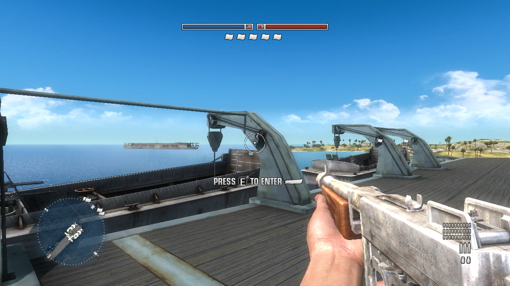
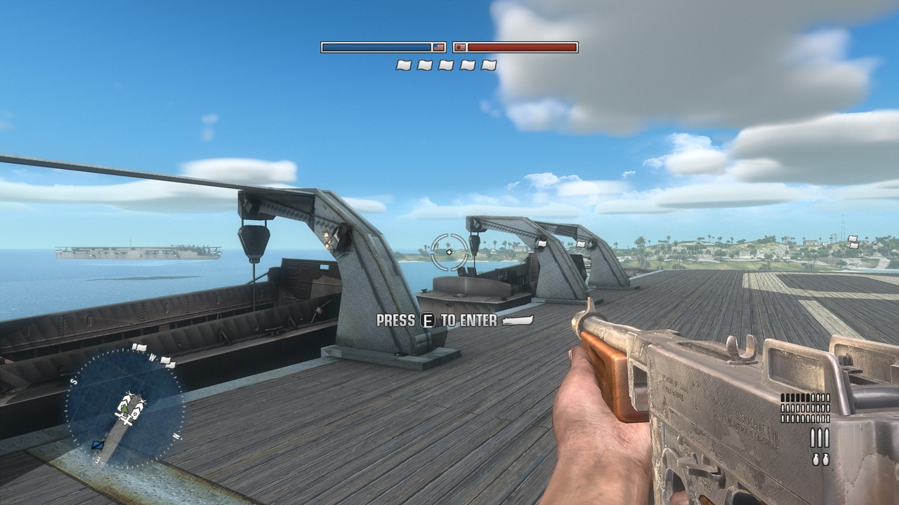
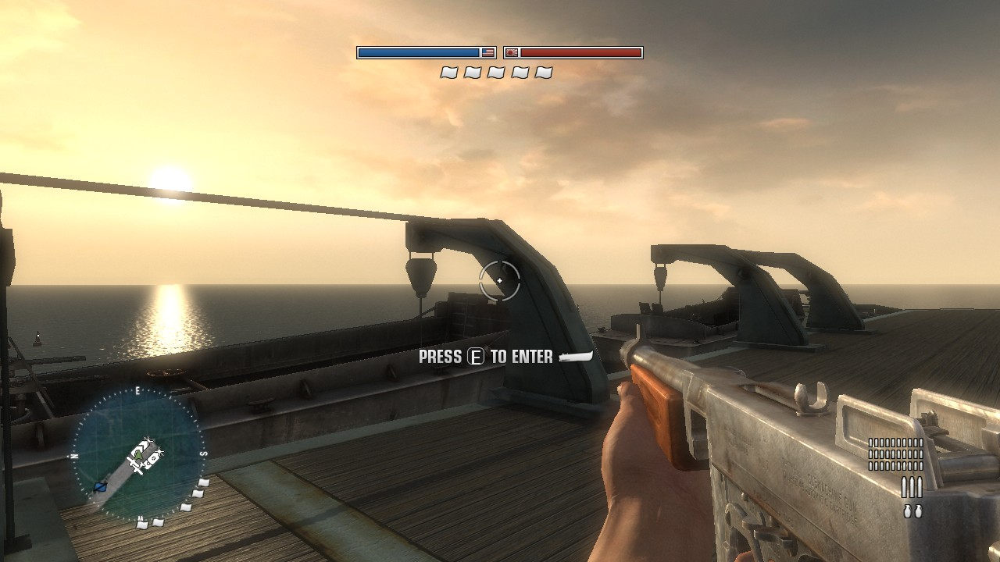
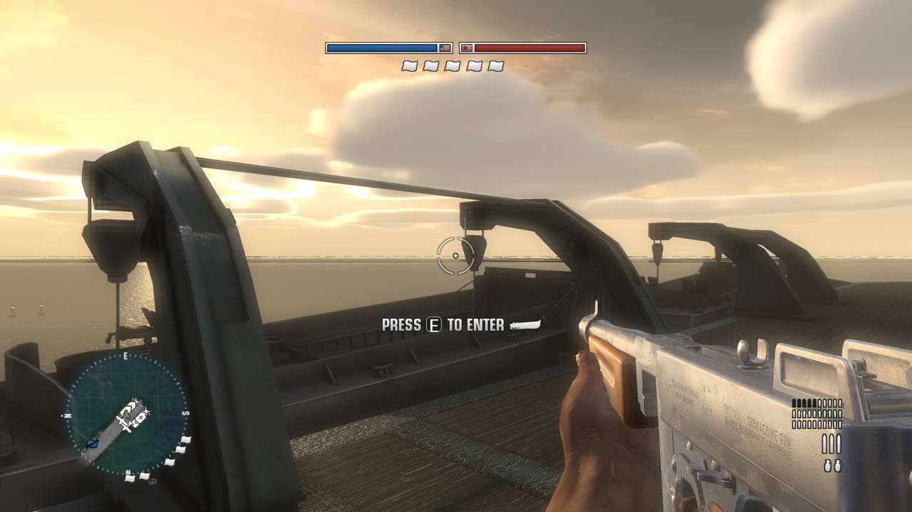
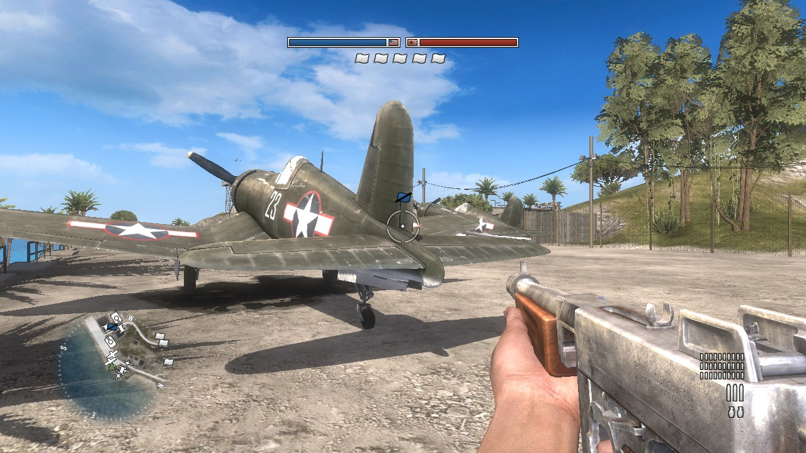
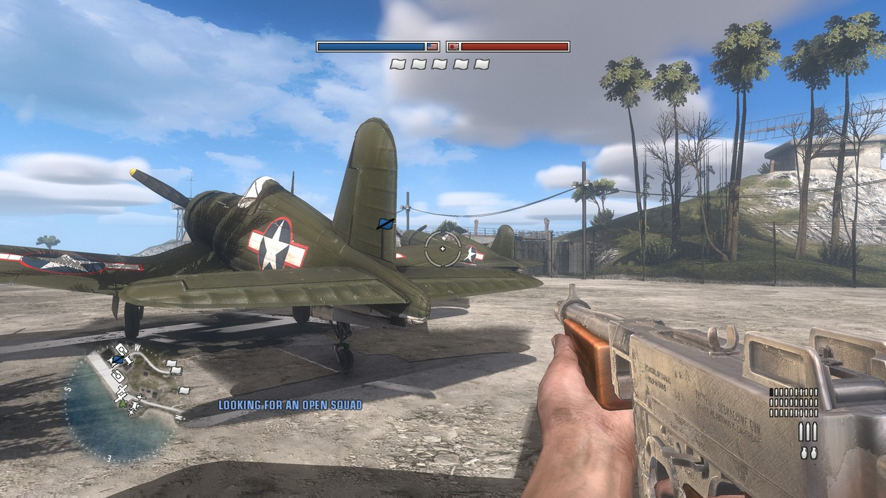
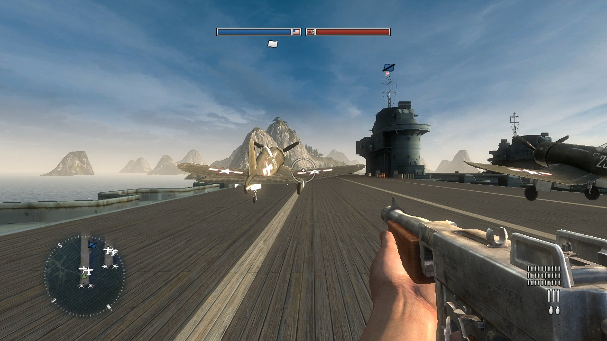
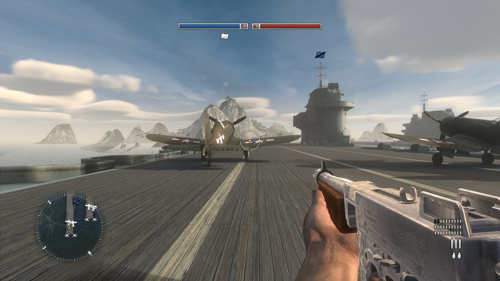
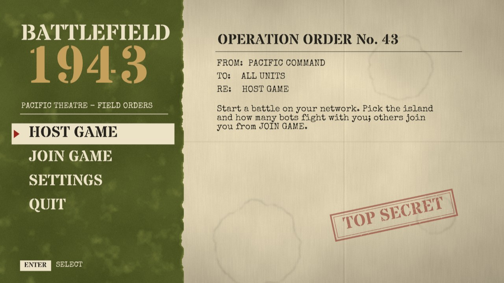
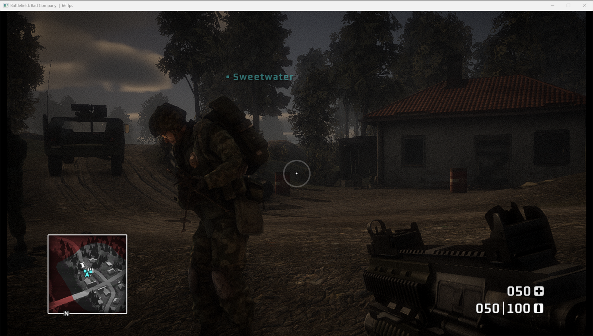

# Battlefield 1943 - Xbox 360 Recomp
An unofficial native PC port of the Xbox 360 version of Battlefield 1943, with extended graphics options, keyboard and mouse support, multiplayer with bots, and other enhancements.

This port was created using the [XenonRecomp](https://github.com/hedge-dev/XenonRecomp) tool, with a Vulkan renderer based on [Xenia](https://github.com/xenia-project/xenia)'s GPU backend. Battlefield: Bad Company is in progress with the same tools.

> [!NOTE]
> This project does not include any game assets. You must provide the files from your own legally acquired copy of the game to install or build.

## Installation
The latest version of the launcher can be found in the [Releases](https://github.com/papand7/Battlefield-Recompilation-Project/releases) page.

- Put `BattlefieldLauncher-<version>.exe` in a folder together with your game files: Battlefield 1943 **version 1.06** (the game package, or `default.xex` in an unpacked folder), and/or Battlefield: Bad Company (the **USA disc** `.iso`, or `default.xex` in an unpacked folder).
- Run it, pick a game at the top and press **INSTALL** (or **Choose game files…** first, if your files are somewhere else). It checks your files, installs the free build tools it needs through winget, and compiles the game's code for your PC, which takes about 5 to 60 minutes and only happens once.
- Press **Play**. Settings can be adjusted in the launcher, or in game under **Settings**, opened with <kbd>F10</kbd> at any time.

| Default | Ultra |
|---|---|
|  |  |
|  |  |
|  |  |
|  |  |

## Features
### Display
- **Resolution** - Up to 4K, with a resolution scale of 1x, 2x or 3x.
- **Upscaling** - AMD FSR.
- **Max Frame Rate** - 60, 120, 144, 165, 240 or unlimited, with the game running smoothly at them.
- **HDR Output** - On HDR monitors.

### Graphics
- **Ray-traced Shadows** - On GPUs with ray tracing, every object, tree and hill casts a proper shadow, even from off screen. Without it, screen-space shadows are used instead.
- **Ray-traced Lighting** - Bounce light and ambient occlusion.
- **Atmosphere** - Light shafts and haze, volumetric clouds and their shadows.
- **Water** - Foam along ships and beaches, clear turquoise shallows, and waves that bend what's below.
- **Surface Depth** - Parallax, and small details like pebbles and cracks on bare ground.
- **Muzzle Flash** - A realistic flash that lights only what's near your gun.
- **Looks** - Enhanced, Toon, Noir and WW2 newsreel film, or Stock for the original.
- **Blood and Gore** - Optional.

### Textures
- **HD Texture Pack** - Realistic materials: metal shines, wood and rust look rough.

### Input
- **Mouse and Keyboard** - Full keyboard and mouse support, with every key rebindable under **Settings → Keys**.
- **Vehicles on the Keyboard** - W and S for throttle and brake, A and D to steer, and the arrow keys to fly planes, with a separate plane mouse sensitivity.
- **Controller** - A connected controller works too.

### Menus
- **New Menus** - A WW2 field-orders look, animated, and made for mouse, keyboard and controller alike. The original intro and title screen are kept.



### Multiplayer
- **LAN Multiplayer** - Host and join on your network. **Host Game** and **Join Game** are being rebuilt for the new menus and don't work at the moment; a dedicated server works.
- **Join by Address** - **Join Game → Address**, or start the game with `--join <address> --host-map <its map>`.
- **Dedicated Server** - Runs in a console window with no graphics, on Windows (`start_server.bat`) or Linux (`start_server.sh`, experimental).
- **List on the Internet** - Shows a server in everyone's **Join Game** list through the master server: `PUBLISH=1` in the start script, `--publish`, or **List on the internet** when hosting from the game. The router must pass UDP ports 1003 and 19430 to the server.
- **Bots** - Computer players on your server, half on each team: they capture flags, fight, sprint, drive landing craft, jeeps and tanks, and fly planes. They play inside the server itself, with no extra copies of the game running.
- **Learning Bots** - Every server learns from its matches where players go, where they die and where they win fights, per map. Bots use it to hold good spots at a flag and to watch where enemies usually come from, and what servers learned can be merged into the next version (`tools/bot_knowledge.py`).

### Dedicated Server
Edit and run `start_server.bat` (name, maps to rotate through, bots and `PUBLISH`), or:
```
bf1943.exe --game <your game files> --dedicated --name "My Server" --maps Wake_island_s,Iwo_Jima_s --bots 4 --publish
```
The host's firewall needs to let the game through: UDP ports 1003 and 19430. For the Linux server, see [the developer guide](docs/DEVELOPERS.md).

**Bot advisor (optional)** - `BOT_LLM=1` in the start script: when a bot keeps getting stuck or is losing a fight, a small vision model (Qwen3.5 4B through llama.cpp, on the server's own PC) is shown a map of its surroundings and picks where it should go. The first start installs it into `llm/` (about 3.5 GB, needs Python; `tools/setup_bot_llm.py`), then the server runs with `--bot-llm llm`. It is faster with a graphics card; on a CPU an answer takes several seconds, and the bots carry on as usual meanwhile. Works for both games' servers (`--bot-llm` on Bad Company's too).

## Battlefield: Bad Company
The same recompiler is being used for Battlefield: Bad Company (Xbox 360).

- **Campaign** - Plays at about 100 fps at 1x render scale, with keyboard, mouse and the HUD working.
- **LAN Multiplayer** - **MULTIPLAYER** on the main menu opens a new menu: **Host Game** (Gold Rush on one of the 8 maps: Valley Run, Deconstruction, Oasis, Final Ignition, End of the Line, Ascension, Harvest Day, Over and Out), **Server Browser** (the games on your network, with map and ping) and **Join by Address** (add `:port` if it isn't the usual 1503). Two copies on one PC can play together; across two PCs it hasn't been tested yet.
- **Ports** - UDP 1500-1503 and 19431, so it can host on the same PC as Battlefield 1943.
- **Only Gold Rush** - The disc has no Conquest; that came later in an update.
- **Idle Players** - A player who stays on the spawn screen for about two minutes without deploying is sent back to the menu (the game's own rule).
- **Not Done Yet** - Bots, playing online, ray-traced shadows (they stall the opening cutscene), blood and the HD texture pack. Saving the campaign hasn't been checked yet.



## System Requirements
### Minimum
- **OS**
  - Windows 10 or 11, 64-bit
- **GPU** with support for Vulkan
- **For the ray-traced effects:** a GPU with ray tracing, such as NVIDIA RTX or AMD Radeon RX 6000 and newer

> [!NOTE]
> Still being worked on: Bad Company, hosting and joining in the new menus, smarter bots (they still get stuck on some shores and walls), softer edges on ray-traced shadows up close, and an occasional crash at 4K.

## Building
### 1. Clone the Repository
Clone this repository using [Git](https://git-scm.com/).
```
git clone https://github.com/papand7/Battlefield-Recompilation-Project.git
```

### 2. Add the Required Game Files
Place your Battlefield 1943 files in `bf1943-recomp/original/v106/`, with `default.xex` there (and Bad Company's in `bfbc1-recomp/original/`).

### 3. Install Dependencies
- CMake 3.25 or newer, and Ninja
- Visual Studio with the C++ build tools
- LLVM (clang-cl)
- The Vulkan SDK, with `VULKAN_SDK` set

### 4. Build the Project
Recompile the game's code with XenonRecomp and build the game; the commands are in [`bf1943-recomp/README.md`](bf1943-recomp/README.md), and how it all works in [the developer guide](docs/DEVELOPERS.md).

---

Battlefield is a trademark of Electronic Arts. This is a fan project, not affiliated with EA or DICE.
