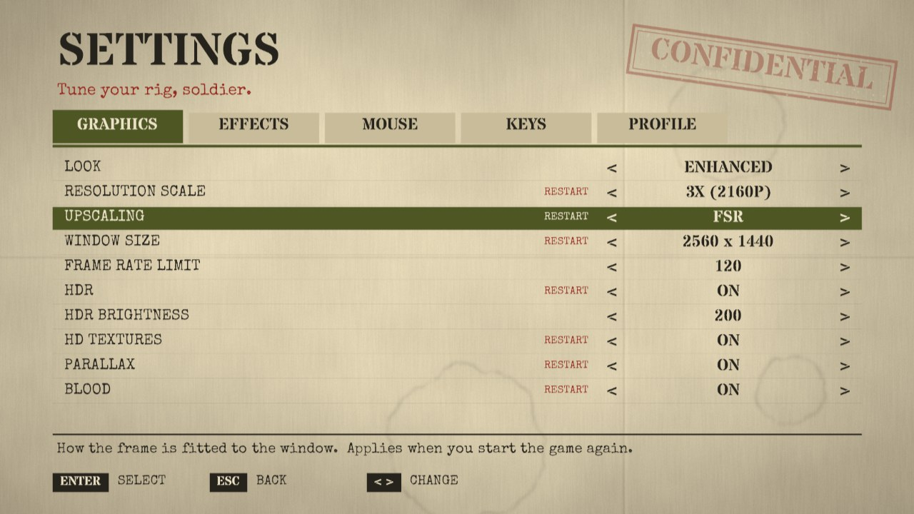
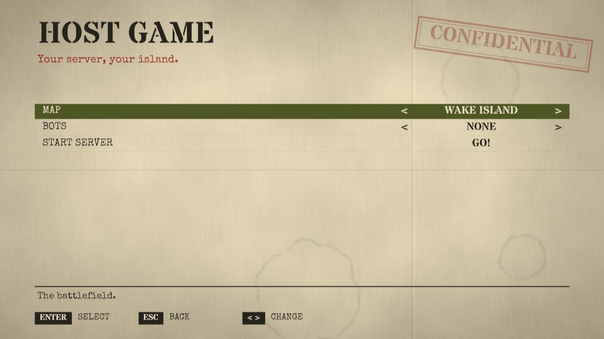
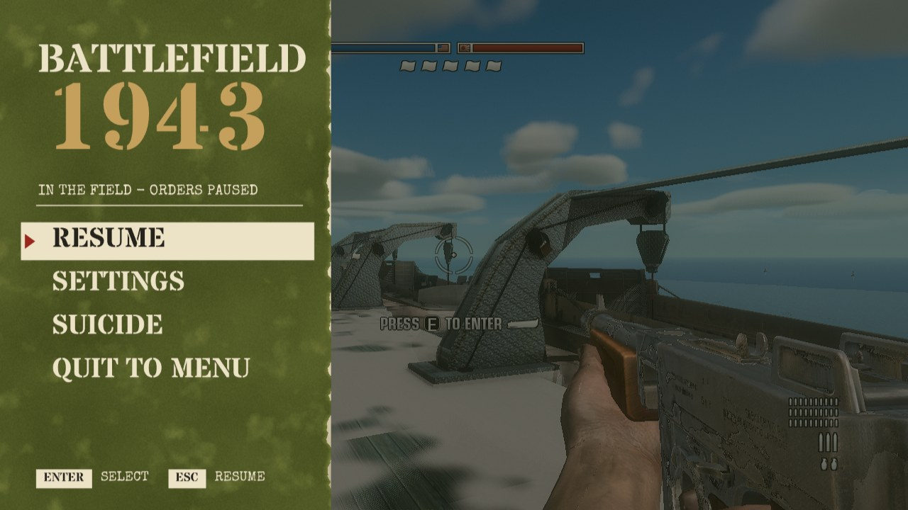
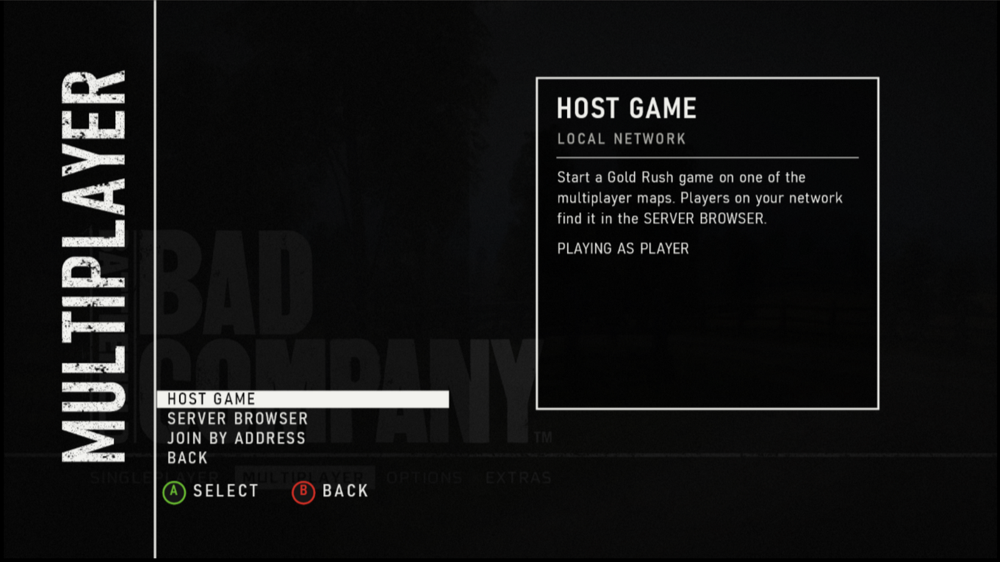

# Battlefield Recompilation Project

**Battlefield 1943, running natively on PC.** The Xbox 360 classic, rebuilt to run on
Windows at high frame rates and resolutions, with modern graphics, full mouse and keyboard
controls, LAN multiplayer with bots, and a brand-new menu.

Battlefield: Bad Company is in progress: it boots, plays its first mission at about 100 fps
with keyboard and mouse, and logs in to the local online service. Hosting isn't working yet.

> You need your own copy of the game. Nothing from the game itself is included here.

---

## Default vs Ultra

Left: the game as it looked on Xbox 360. Right: Ultra, with everything turned on, in 4K.

| Default | Ultra |
|---|---|
|  |  |
|  |  |
|  |  |
|  |  |

## The new menus

A WW2 field-orders look, animated, and made for mouse, keyboard and controller alike.
The original intro and title screen are kept.

| | |
|---|---|
|  |  |
|  |  |

---

## What you get

**Looks**
- Up to **4K** (resolution scale 1×, 2× or 3×) with **AMD FSR** upscaling.
- **High frame rates**: 60, 120, 144, 165, 240 or unlimited, and the game runs smoothly at them.
- **HD texture pack** with realistic materials: metal shines, wood and rust look rough.
- **Ray-traced shadows** (on GPUs that support it): every object, tree and hill casts a proper shadow, even from off screen.
- **Ray-traced bounce light**, **ambient occlusion**, **light shafts and haze**, **volumetric clouds** and their shadows.
- **Better water**: foam along ships and beaches, clear turquoise shallows, waves that bend what's below.
- **Surface depth** (parallax) and small details like pebbles and cracks on bare ground.
- **A realistic muzzle flash** that lights only what's near your gun.
- **HDR** on HDR monitors.
- **Looks**: Enhanced, Toon, Noir and WW2 newsreel film, or Stock for the original.
- Optional **blood and gore**.

**Plays**
- Proper **mouse and keyboard**, every key rebindable; a controller works too.
- **Vehicles on the keyboard**: W/S for throttle and brake, A/D to steer, arrow keys to fly planes,
  and a separate plane mouse sensitivity.
- **Host a game** and **join** one are being rebuilt for the new menus, so they aren't working
  right now (they worked with the original menus). A dedicated server still runs from the console.

## Playing

You need your own copy of Battlefield 1943 for Xbox 360, **version 1.06** (the game package
file, or `default.xex` in an unpacked folder). Nothing of the game is included here.

1. Download the release and unzip it anywhere, then start **Launcher\BF1943Launcher.exe**.
2. The first time, the launcher sets the game up for you: press **Choose game files…**, pick
   your game package, then press **INSTALL**. It:
   - copies your game files and checks that they are version 1.06,
   - installs the free build tools it needs (LLVM, CMake, Visual Studio C++ build tools,
     Vulkan SDK) through winget,
   - recompiles the game code and builds the game on your PC (about 20-60 minutes).
   Keep the launcher open while it works.
3. Pick your settings and press **Play**.

Everything can also be changed in game under **Settings** (or press **F10** at any time).

### Controls (keyboard and mouse)

| Action | Key |
|---|---|
| Move | W A S D |
| Look / aim | Mouse |
| Fire | Left mouse |
| Zoom / aim down sights | Right mouse |
| Jump | Space |
| Crouch | Ctrl or C |
| Sprint | Shift |
| Reload | R |
| Enter vehicle / use | E |
| Knife | F or V |
| Grenade | G or middle mouse |
| Switch weapon | 1, 2 or mouse wheel |
| Scoreboard | Tab (hold) |
| Pause menu | Esc |
| Settings | F10 |

**In vehicles:** W accelerates, S brakes or reverses, A and D steer. **In planes:** W is the
throttle, A and D the rudder, and the arrow keys or the mouse pitch and roll.

All keys can be changed under **Settings → Keys**.

### Multiplayer

- **Host Game** and **Join Game** are not working in the rewritten menus at the moment. Use
  a dedicated server (below), and the bot setup is still available through the command line.
- The host's firewall needs to let the game through (UDP ports 1003 and 19430).

### Run your own server

A dedicated server runs in a console window, with no graphics, and shows up in everyone's
**Join Game** list. Edit and run `start_server.bat` (name, maps to rotate through, bots), or:

```
bf1943.exe --game <your game files> --dedicated --name "My Server" --maps Wake_island_s,Iwo_Jima_s --bots 4
```

**Linux server (experimental):** a native Linux build of the dedicated server
(`bf1943_server`) runs on Ubuntu 24.04 (tested in WSL2), and the Windows game can join
it. See [the developer guide](docs/DEVELOPERS.md) to try it.

To join a server that isn't on your network: **Join Game → Address**, or start the game with
`--join <address> --host-map <its map>`.

## Battlefield: Bad Company (work in progress)

The same recompiler is being used for Battlefield: Bad Company (Xbox 360). Current state:

- Boots to the menu and runs the first mission at about 100 fps at 1× render scale, with
  keyboard, mouse and the HUD working.
- Online login works against the local service, and the server list reports "no games"
  because nothing is hosted yet. Hosting isn't working.
- Not done yet: ray-traced shadows (they stall the opening cutscene), blood, the HD texture
  pack, and saving the campaign.

| In game | Multiplayer menu |
|---|---|
|  |  |

## Good to know

- Ray-traced effects need a GPU with ray tracing (for example NVIDIA RTX or AMD RX 6000 and newer).
  Without it you still get everything else, with screen-space shadows instead.
- Still being worked on: Bad Company, hosting and joining in the new menus, smarter bots (they take landing craft, jeeps, tanks and planes, but still get stuck on some shores and walls), softer edges on ray-traced shadows
  up close, and an occasional crash at 4K.

---

Battlefield is a trademark of Electronic Arts. This is a fan project, not affiliated with EA or DICE.
How it works and how to build it: [docs/DEVELOPERS.md](docs/DEVELOPERS.md).
