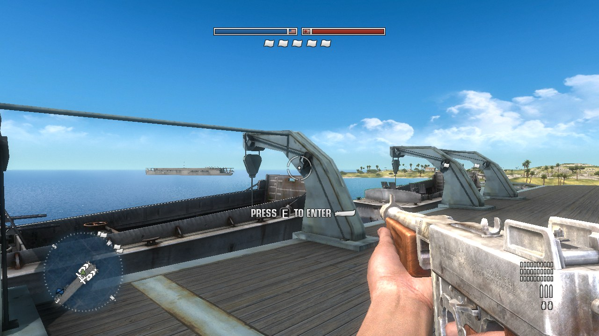
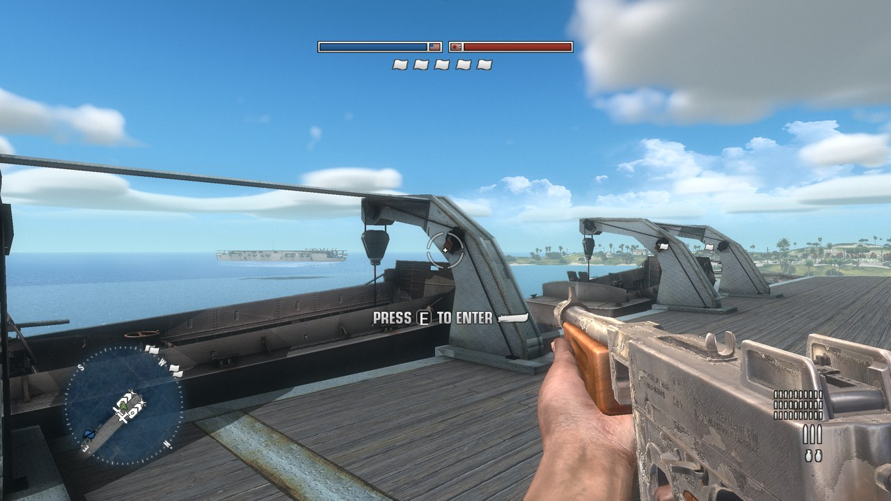
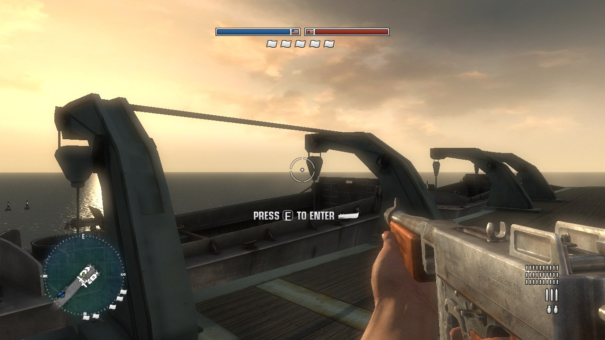
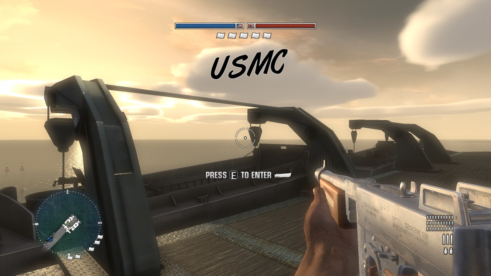
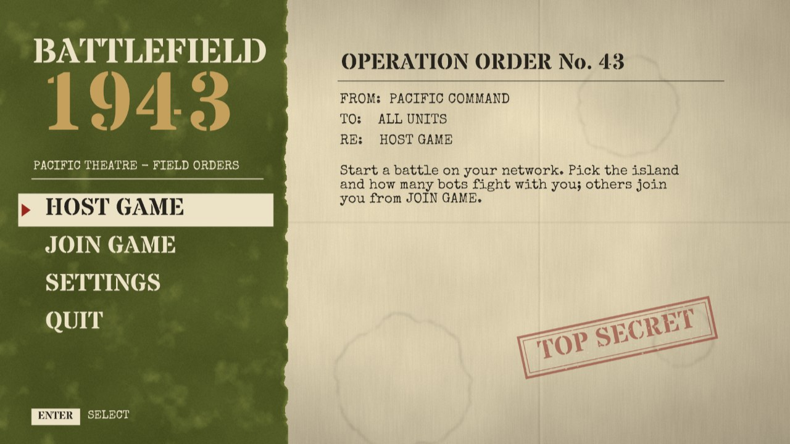
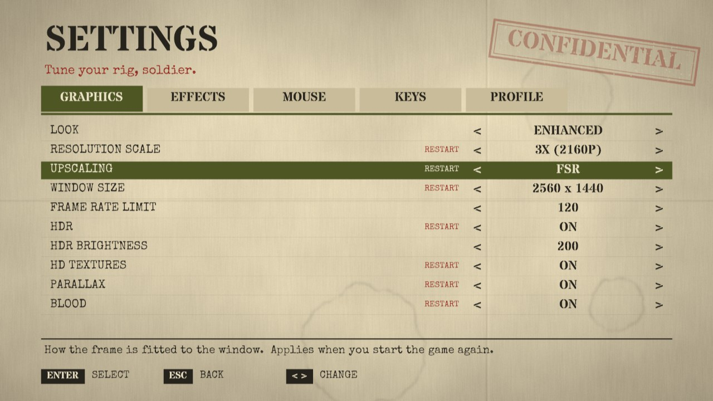
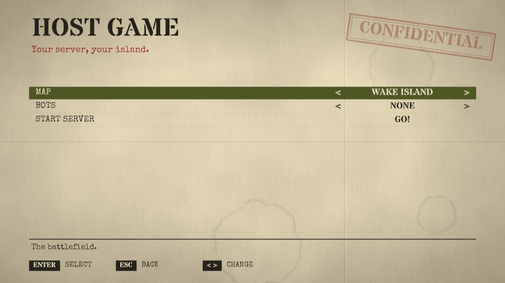
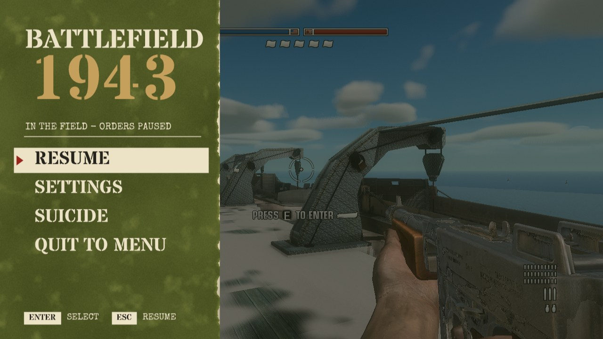

# Battlefield Recompilation Project: developer guide

Native Windows x64 ports of two Xbox 360 Battlefield games, built by statically
recompiling their PowerPC code with [XenonRecomp](https://github.com/hedge-dev/XenonRecomp)
and rendering through Vulkan with a modified [Xenia](https://github.com/xenia-project/xenia) GPU backend.

| Project | Game | State |
|---|---|---|
| [`bf1943-recomp/`](../bf1943-recomp/) | Battlefield 1943 (XBLA, v1.06) | Playable: all maps, LAN host/join, bots, full PC feature set |
| [`bfbc1-recomp/`](../bfbc1-recomp/) | Battlefield: Bad Company | In progress, shares the bf1943 runtime and renderer |

**No game files or recompiled game code are included.** Put your own dump in
`bf1943-recomp/original/v106/` (and `bfbc1-recomp/original/`), then generate and build
as described in [`bf1943-recomp/README.md`](../bf1943-recomp/README.md) (build steps, every command-line option and how each feature works).

## Before / after

Left: the game's own rendering (`--preset stock`, 1280×720). Right: this project
(`--preset enhanced`, HD/PBR texture pack, 2560×1440 with FSR; shown downscaled).

| Stock | Enhanced |
|---|---|
|  |  |
|  |  |

## Menus

The game's own intro and title screen are kept; from the main menu on, the PC menus
take over: a WW2 field-orders look (aged paper, olive drab, stencil and typewriter
type), animated, for mouse, keyboard and controller alike.

| | |
|---|---|
|  |  |
|  |  |

## Features (Battlefield 1943)

### Port
- Static recompilation of the whole game to x64 (clang-cl), no emulated CPU.
- Vulkan 1.3 renderer (Xenia's Xenos → SPIR-V translator, vendored and extended).
- Audio through Xenia's XMA decoder (FFmpeg) and XAudio2.
- Electron launcher: finds the game and texture pack, resolution, upscaling, shadows,
  frame rate, window size, HD textures, PBR, look presets, HDR.

### Graphics
- **Resolution scale** 1–3× of 720p, **AMD FSR / CAS** upscaling and sharpening.
- **Uncapped frame rate** (`--max-fps`, default 120) with the client simulation ticking at the same rate.
- **HD texture pack** (`tools/texpack`) with **PBR materials**: GGX metal/roughness lighting,
  roughness-blurred cube-map reflections, 16× anisotropic filtering.
- **Parallax occlusion mapping** from height maps in the pack's normal maps.
- **Ray-traced sun shadows** (Vulkan ray queries): every world mesh, multi-part vehicles,
  alpha-tested foliage and the full terrain heightmap; casters off screen still cast.
- **Screen-space sun shadows** on GPUs without ray tracing.
- **Ray-traced bounce lighting (GI)** with a world-space colour cache and contact darkening.
- **GTAO ambient occlusion**.
- **Volumetric light shafts and height fog**, fog matched to the horizon sky.
- **Volumetric clouds** with cloud shadows on the ground.
- **Water**: wave refraction, foam along hulls and beaches, clear turquoise shallows,
  sea and surface reflections.
- **Muzzle-flash light** replaced by a short-range shadowed light (the game's lit the whole scene).
- **Procedural surface detail**: grime, pebbles and cracks on bare ground.
- **Larger shadow map** (1600², 300 m) and **4× vegetation draw distance**.
- **HDR10 output** with adjustable paper white and peak.
- **Looks**: stock, enhanced, toon, noir and WW2 newsreel film.
- **Blood and gore** (optional): hit sprays, pools, bodies breaking apart on explosive kills.

### PC controls and menus
- Full **mouse and keyboard**: raw mouse look, rebindable keys, controller still works.
- **Vehicle keys**: W/S throttle and brake, A/D steering or rudder, arrow keys pitch and
  roll planes, separate **plane mouse sensitivity** and invert.
- **PRESS ANY KEY** title; any key or mouse button starts.
- **New main menu** (HOST GAME, JOIN GAME, SETTINGS, QUIT) replacing the game's: its
  buttons call the game's own code directly (`hostMultiplayerLocal`), the game's front end
  runs hidden underneath.
- **New pause menu** (Esc / Start in a level: RESUME, SETTINGS, SUICIDE, QUIT TO MENU) over
  the live game; suicide and quit work the game's own menu unseen behind a STAND BY screen.
- **Settings** (also F10 anywhere): every graphics option and effect, mouse, plane mouse,
  key bindings, multiplayer name; most apply live.
- Menus answer the mouse (hover, click, right click = back), keyboard and controller
  (D-pad / stick, A, B, LB/RB for pages); `BF_STOCK_MENUS=1` brings back the game's own.

### Multiplayer
- **HOST GAME**: pick the map (Wake Island, Iwo Jima, Guadalcanal, Coral Sea air
  superiority) and bot count; no sign-in needed.
- **JOIN GAME**: LAN server browser, or join by address.
- **Bots**: AI players for hosted games (control-point strategy, combat, swimming ashore).
- Optional EA-server emulator (`server/arcadia360`, Arcadia, GPL-2.0).

## Layout
- `bf1943-recomp/runtime/`: the native host (kernel/XAM, memory, threads, input, network, PC menus, bots), shared with bfbc1.
  The menus: `pc_settings.cpp` (screens and input), `pc_menu.cpp` (the look, GDI+ on its own thread).
- `bf1943-recomp/thirdparty/xenia/`: the GPU backend with all render features (`gpu/vulkan/scene_fx*`, `gpu/shaders/`).
- `bf1943-recomp/tools/`: XenonRecomp helpers, texture pack builder, menu patcher, PBR table generator.
- `bf1943-recomp/launcher/`: the launcher.
- `bfbc1-recomp/`: Bad Company build files and game-specific code.

## Licences
Project code: as noted per directory. Third-party: XenonRecomp (MIT), Xenia (BSD-3),
VulkanMemoryAllocator (MIT), FFmpeg subset (LGPL-2.1), Arcadia (GPL-2.0).
Fonts in `bf1943-recomp/data/fonts`: Stardos Stencil (SIL OFL 1.1), Special Elite (Apache 2.0).
Battlefield is a trademark of Electronic Arts; this project is not affiliated with EA or DICE.

## Linux dedicated server (builds; not yet run on Linux)

`bf1943-recomp/game/linux/CMakeLists.txt` builds `bf1943_server`: the recompiled game and the
runtime with clang on Linux, without GPU, audio, window, PC menus or bots
(`runtime/linux_server.cpp` has their stand-ins). The runtime's Windows calls have POSIX
versions: memory (`mmap`/`mprotect`, the physical views through `memfd`), threads,
files (`posix_files.h`, case-insensitive paths), sockets (`posix_net.h`, Winsock error
codes and option numbers mapped), time and SHA-1 (`posix_compat.h`, `sha1.h`).

```
cmake -S bf1943-recomp/game/linux -B build/linux -G Ninja -DCMAKE_BUILD_TYPE=Release       -DCMAKE_C_COMPILER=clang -DCMAKE_CXX_COMPILER=clang++
cmake --build build/linux
build/linux/bf1943_server --game <your dump> --dedicated --name "My Server" --maps Wake_island_s
```

It also builds on Windows, cross-compiled with LLVM for Windows and a Debian sysroot:

```
python bf1943-recomp/tools/fetch_linux_sysroot.py bf1943-recomp/build/linux-sysroot
cmake -S bf1943-recomp/game/linux -B bf1943-recomp/build/linux -G Ninja -DCMAKE_BUILD_TYPE=Release       -DCMAKE_TOOLCHAIN_FILE=bf1943-recomp/game/linux/cross-from-windows.cmake
cmake --build bf1943-recomp/build/linux
```

That build compiles and links (an x86-64 ELF), but hasn't been run on Linux yet. Known gaps: no bots (shared memory and
process launch), silent XMA (the stand-in reports every buffer consumed; the game's mixer
may not like that), and no full Linux client (Vulkan presenter, input, audio).
